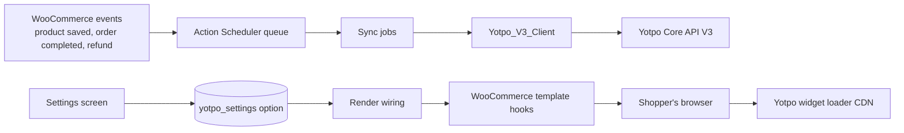
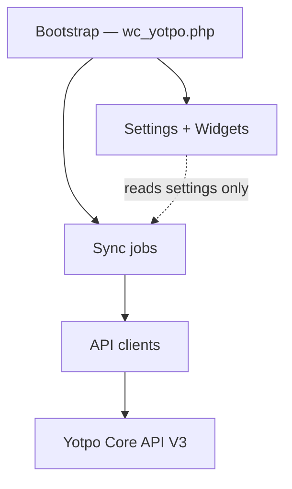

# Architecture

## System Overview

A WordPress plugin that connects one WooCommerce store to one Yotpo account, identified by an
app key and secret the merchant pastes into the settings screen. It has two halves that share
nothing but those credentials: a **storefront half** that injects Yotpo's widget markup into
WooCommerce template hooks, and a **sync half** that pushes the store's catalog and orders to
Yotpo's Core API V3 from background jobs. The plugin stores no data of its own beyond WordPress
options, post meta and transients.

## Module Map

| Module | Responsibility | Key Files | Owner |
|--------|---------------|-----------|-------|
| Bootstrap | Plugin header, hook registration, activation/uninstall, storefront entry | `trunk/wc_yotpo.php`, `trunk/uninstall.php` | orbits |
| Settings | The single `yotpo_settings` option, defaults, legacy fill, admin screen | `trunk/lib/utils/wc-yotpo-defaults.php`, `trunk/templates/` | orbits |
| Widgets | Per-widget markup and where each renders | `trunk/lib/widgets/`, `trunk/lib/utils/widgets-rendering-logic.php` | orbits |
| API clients | Core API V3 transport (token, pacing, retry) and the widget-ID lookup | `trunk/lib/yotpo-api/` | orbits |
| Catalog sync | Product and variant upsert, fingerprints, blocklisting | `trunk/lib/sync/class-yotpo-catalog-api.php`, `class-yotpo-product-sync.php` | orbits |
| Order sync | Orders on fulfilment, refund updates, 30-day stats | `trunk/lib/sync/class-yotpo-order-sync.php`, `class-yotpo-order-api.php` | orbits |
| Backfill | Past-order send and the daily sweep for ones that were missed | `trunk/lib/sync/class-yotpo-order-backfill.php` | orbits |
| Job plumbing | Action Scheduler wiring, retries, rate-limit pause, stall detection | `trunk/lib/sync/class-yotpo-sync-jobs.php`, `class-yotpo-sync-state.php`, `class-yotpo-option-lock.php` | orbits |
| Export | Review CSV export from the admin screen | `trunk/classes/class-wc-yotpo-export-reviews.php` | orbits |

## Data Flow

Two independent directions. Nothing flows from Yotpo into the store except widget IDs and the
widget markup the browser fetches directly from Yotpo's CDN.

## Key Abstractions

- **`Yotpo_V3_Client`** — the only way to reach the Core API. It owns the access token, paces calls
  to five per second per app key, and replaces a token Yotpo refuses exactly once.
  `trunk/lib/yotpo-api/class-yotpo-v3-client.php:52`
- **Fingerprints** — a hash of the payload Yotpo last accepted, kept in post meta. A job that finds
  an unchanged fingerprint sends nothing, which is what keeps a bulk product edit from becoming
  thousands of API calls. `trunk/lib/sync/class-yotpo-catalog-api.php:19`
- **`Yotpo_Option_Lock`** — a short-lived option-based lock with a TTL, so two concurrent jobs
  updating the same shared option don't lose each other's writes. `class-yotpo-option-lock.php:25`
- **Legacy settings fill** — every read of `yotpo_settings` is merged over "what a missing key meant
  before it existed" rather than over the new-install defaults. This is why a store upgrading from
  1.x doesn't silently acquire features it never enabled.
  `trunk/lib/utils/wc-yotpo-defaults.php:60`

## Extension Points

- To add a **storefront widget**, add its markup to `trunk/lib/widgets/`, a render function to
  `trunk/wc_yotpo.php`, its placement to `trunk/lib/utils/widgets-rendering-logic.php`, its enable
  flag to `v3_widgets_enables` in `wc-yotpo-defaults.php`, and a checkbox to
  `trunk/templates/reusables/widgets-settings.php`.
- To sync a **new WooCommerce event**, add the hook in `Yotpo_Sync_Jobs::register()` and a job hook
  constant beside the existing `HOOK_*`.
- To add a **setting**, add it to `wc_yotpo_get_default_settings()` and decide what a missing key
  means in `wc_yotpo_legacy_missing_settings()`. Skipping the second step is a behavior change for
  every existing store.

## Boundaries

- **`trunk/` must not depend on anything outside `trunk/`.** Only `trunk/` is mirrored to
  WordPress.org; a reference to `vendor/`, `tests/` or a repo-root file is a fatal error on a
  merchant's site. Composer dependencies are dev-only.
- **`trunk/uninstall.php` must not use the plugin's classes.** WordPress runs it without the plugin
  loaded, so it repeats the option, meta and group names as literals.
- **Widget modules must not call the API clients.** Widgets emit markup; the browser fetches
  content from Yotpo's CDN. The only admin-side API call for widgets is the widget-ID lookup.
- **Sync modules must not render.** They run in job context with no page to write to.

## Dependency Graph

**Forbidden imports:**
- `trunk/**` must not import from `vendor/`, `tests/` or the repo root — they do not ship.
- `trunk/uninstall.php` must not import any plugin class — it runs unloaded.
- `trunk/lib/widgets/**` must not import `trunk/lib/yotpo-api/**` — widgets render, they don't call.

## Domain Ownership

| Domain | Owner | State it owns | Workers/Jobs | Key Invariants | Known Fragility |
|--------|-------|---------------|--------------|----------------|-----------------|
| Settings | orbits | `yotpo_settings` | — | A key missing from a saved setting reads as its legacy meaning, not its default | Adding a key without a legacy meaning changes behavior for every upgrading store |
| Catalog sync | orbits | `_yotpo_v3_product_id`, `_yotpo_v3_variant_id`, `*_hash`, `_yotpo_v3_blocklisted` | `wc_yotpo_sync_product`, `wc_yotpo_sync_product_batch`, `wc_yotpo_discontinue_variant`, `wc_yotpo_sync_tagged_products` | A product is sent only when its fingerprint changed | A batch is capped at the API's lookup maximum; raising `BATCH_SIZE` past it silently truncates comparisons |
| Order sync | orbits | `_yotpo_v3_order_id`, `_yotpo_v3_order_hash`, `wc_yotpo_order_sync` | `wc_yotpo_send_order`, `wc_yotpo_update_order` | Orders are sent once, on reaching the fulfilled status | Order meta lives in post meta **or** WooCommerce's HPOS tables; both have to be cleaned on uninstall |
| Backfill | orbits | `wc_yotpo_order_backfill`, `wc_yotpo_order_settled_*` | `wc_yotpo_send_past_orders_page`, `wc_yotpo_order_sweep`, `wc_yotpo_order_sweep_page` | The sweep never re-sends an order it already settled | A run with no job left and no progress for an hour counts as dead and is restarted |
| Widgets | orbits | `v3_widgets_ids`, `v3_widgets_enables`, `v2_widgets_enables` | — | V2 and V3 stores take different render paths and share no flags | A widget type the plugin doesn't render must not be stored under an empty key |

## Cross-Domain Flows

### Product reaches Yotpo
**Trigger:** `woocommerce_new_product` / `woocommerce_update_product`, a term change, or the initial
full sync.

**Execution order:**
1. `Yotpo_Sync_Jobs::queue_product()` schedules a job (domain: job plumbing)
2. The job builds a payload and compares its fingerprint (domain: catalog sync)
3. Unchanged → stop. Changed → `Yotpo_V3_Client::request()` (domain: API clients)
4. The new fingerprint and Yotpo ID are written to post meta

**Failure modes:**
- 429 → every job pauses until `wc_yotpo_product_sync_paused_until` expires, at least 5s
- Retryable error → requeued with doubling delay, up to `MAX_ATTEMPTS`
- Running with no jobs left and no progress for `STALL_AFTER` → restarted, up to
  `MAX_STALL_RESTARTS`, then left stalled for the merchant

### Order reaches Yotpo
**Trigger:** `woocommerce_order_status_changed` into the configured fulfilled status, or
`woocommerce_order_refunded`.

**Execution order:**
1. The status change queues `wc_yotpo_send_order` at priority 5, ahead of product jobs
   (`class-yotpo-order-sync.php:25`)
2. The job builds the order payload and sends it
3. Refunds queue an update job against the stored Yotpo order ID
4. The daily sweep re-checks the last 7 days for orders no job sent

**Failure modes:**
- An order Yotpo doesn't have is remembered in a short transient so the sweep doesn't re-ask
- An order the sweep can't send for good is marked settled and never retried

## Architectural Decisions

Index of ADRs (full records live in [`docs/adr/`](docs/adr/)):

| ADR | Decision | Status |
|-----|----------|--------|
| — | None recorded yet | — |

Decisions visible in the code and README that are worth recording as ADRs, in rough priority
order: shipping `trunk/` to WordPress.org by SVN mirror with GitHub `master` as the source of
truth; moving every call onto one Core API V3 access token and dropping the legacy `/oauth/token`;
running sync on Action Scheduler with an option-based lock rather than WP-Cron; duplicating
constants as literals in `uninstall.php`; and keeping the V2 widget path alive for stores that
already use it. Record one with `docs/adr/0000-template.md` and add its row above.

## Constraints

- **Performance:** five Core API requests per second per app key
  (`class-yotpo-v3-client.php:16`); a full-sync page holds at most the API's lookup maximum
  (`class-yotpo-sync-jobs.php:14`). A page job stops creating orders after 15 seconds and hands the
  rest of its page to a new job.
- **Compatibility:** PHP 7.4 and WordPress 6.0 are the floor, declared in three places that must
  agree — the plugin header, `readme.txt`, and `phpcs.xml.dist`'s `testVersion` /
  `minimum_wp_version`. WooCommerce HPOS is declared compatible.
- **Distribution:** the WordPress.org slug `yotpo-social-reviews-for-woocommerce` is permanent, and
  `Stable tag` must point at an existing SVN tag or WordPress.org serves `trunk` instead.

# Citations

[1] Release and development procedure — `README.md` in this repository
[2] WordPress.org listing — https://wordpress.org/plugins/yotpo-social-reviews-for-woocommerce/
[3] Installation guide — https://support.yotpo.com/docs/woocommerce-installing-yotpo
